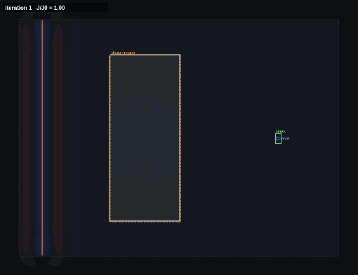

# etchlight

A 2D electromagnetic simulator that runs on your GPU in the browser, with
adjoint-method inverse design on top: draw a photonic device and watch light
move through it, or mark a target and let gradient descent carve the device
for you.

**Live demo:** https://USERNAME.github.io/etchlight/



*The "focus light" preset. The design region starts as uniform grey and after a few dozen iterations has become a lens that no one drew.*

## What it does

- **Simulates Maxwell's equations** (2D, TM polarization) with the
  finite-difference time-domain method on a Yee grid, with a split-field
  perfectly matched layer so waves leave the domain instead of bouncing back.
- **Runs on the GPU** through WebGL2 fragment shaders. A 320×240 grid steps
  hundreds of times per frame on an ordinary laptop. A CPU engine with the
  identical difference equations is the reference implementation and the
  fallback.
- **Measures** things: point monitors accumulate running Fourier transforms,
  so a pulse through a ring resonator gives you its transmission spectrum, and
  the whole-grid DFT gives the steady-state intensity map.
- **Designs devices** with the adjoint method. One forward and one adjoint
  simulation give the gradient of an objective with respect to the
  permittivity of every cell in a design region; a filtered, projected density
  parameterization and Adam turn that into a lens, a 1×2 splitter or a
  low-loss sharp bend.
- **Lets you draw.** Brush dielectrics and metals, drop point and line
  sources, place monitors, drag out design regions and targets, export and
  import scenes as JSON.

Eight presets cover the classics (double slit, dielectric lens, waveguide
bend, ring resonator, photonic crystal) and three inverse-design problems.

## Why I built it

I wanted a project at the intersection of the three things I like: physics,
electrical engineering and writing fast code. Inverse design is how modern
photonic devices are increasingly made, the tools for it (Meep, Lumerical,
ceviche) are desktop or cloud software, and I could not find anything that
let you watch the optimizer work in a browser tab. Building one meant
deriving the adjoint gradient for the *discrete* scheme, not just the
textbook continuous one, and proving it with a finite-difference check.

## How it works

`docs/physics.md` walks through every piece: units and the Yee grid, the
semi-implicit lossy update, the PML and why its conductivity is scaled by
the local permittivity, sources and the DFT, stability and numerical
dispersion, the adjoint derivation with the correction that the leapfrog
scheme needs, the filter/projection parameterization, and the GPU passes.

`docs/validation.md` lists every measured number from the test suite.

## Validation

| Check | Result |
|---|---|
| Fresnel reflection at an n = 2 interface | \|r\| = 0.338 vs 1/3 |
| Vacuum phase velocity at 20 cells/λ | 0.994 c (matches the dispersion relation) |
| PML reflection, 16 cells | -54 dB |
| Reciprocity (source and monitor swapped) | 1e-7 relative |
| Adjoint gradient vs finite differences | cosine similarity 1.00000, scale 1.0001 |
| GPU vs CPU after 600 steps | 7e-7 of the peak field |

All of these run in CI on every push (`npm test` for the physics,
`npm run e2e` for GPU/CPU parity in headless Chromium).

## Two things that went wrong

They are the parts I learned most from, so they are documented rather than
hidden.

**The adjoint gradient was 2% off and I did not know why.** The continuous
derivation gives `dJ/dε = 2ω² Re(E λ)`. Checked against finite differences it
had a cosine similarity of 0.9986 and a fitted scale of 0.976, which is close
enough that the optimizer still worked, and wrong enough that cells with
small gradients were off by up to 80%. The cause: the leapfrog scheme sees
`ω̃ = (2/dt) sin(ω dt/2)` instead of `ω`, and injecting the source after the
curl update multiplies it by `e^{iω dt/2}`. Dividing the adjoint source by
that factor took the cosine to 1.00000 and the scale to 1.0001.

**The GPU disagreed with the CPU by 1e-3 at the source cells.** The shader
evaluated `cos(ωt + φ)` itself, and GPU trigonometry is allowed to be
approximate. All time-dependent trig now runs in double precision on the CPU
and is passed in as uniforms; the shader does multiply-adds only. The
remaining difference, 7e-7, is float32 rounding.

## Running it locally

```bash
npm install
npm run dev        # http://localhost:5173
npm test           # physics + adjoint tests (about 15 s)
npm run build
npm run e2e        # GPU/CPU parity in headless Chromium
```

The e2e script uses software WebGL, so it is slow; it exists to check
correctness, not speed.

## Project layout

```
src/core/      solver, PML, sources, DFT, adjoint, parameterization (pure TypeScript, no DOM)
src/gpu/       WebGL2 engine, shaders, display renderer
src/ui/        the app: canvas interaction, panel, charts
src/presets.ts the experiments
tests/         vitest physics and adjoint tests
e2e/           Playwright parity test and static server
tools/         README media capture
docs/          physics write-up, validation numbers, media
```

Only three runtime-free dev dependencies: Vite, TypeScript, Vitest (plus
Playwright for the browser tests). There is no framework; the UI is about
600 lines of plain DOM code.

## Limitations

- 2D and TM only. Real devices are 3D; 2D captures the physics of planar
  photonics qualitatively and is what the inverse-design papers' tutorials
  use, but the numbers are not fab-ready.
- Materials are non-dispersive. "Metal" is a conductor with σ = 20, which is
  a fine mirror but not a Drude model of gold.
- The split-field PML reflects more at grazing incidence than a CPML would.
- The objective is intensity at target cells. Mode-overlap objectives, which
  is what you want for waveguide devices, are the obvious next step.
- Minimum feature size is enforced by the filter radius only; there is no
  geometric length-scale constraint, so designs can still have thin bridges
  at the projection threshold.
- Optimization with the CPU engine works but is slow; use a browser with
  WebGL2 float render targets (any current desktop browser).

## References

Taflove and Hagness, *Computational Electrodynamics* (3rd ed.); Berenger,
J. Comput. Phys. 114 (1994); Jensen and Sigmund, Laser & Photonics Reviews 5
(2011); Piggott et al., Nature Photonics 9 (2015); Hughes et al., ACS
Photonics 6 (2019); Hammond et al., Optics Express 30 (2022). Full citations
in `docs/physics.md`.

## License

MIT.
