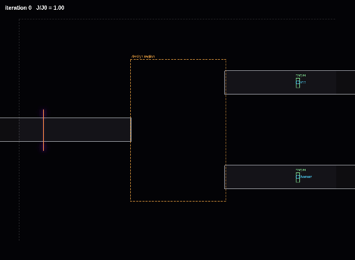
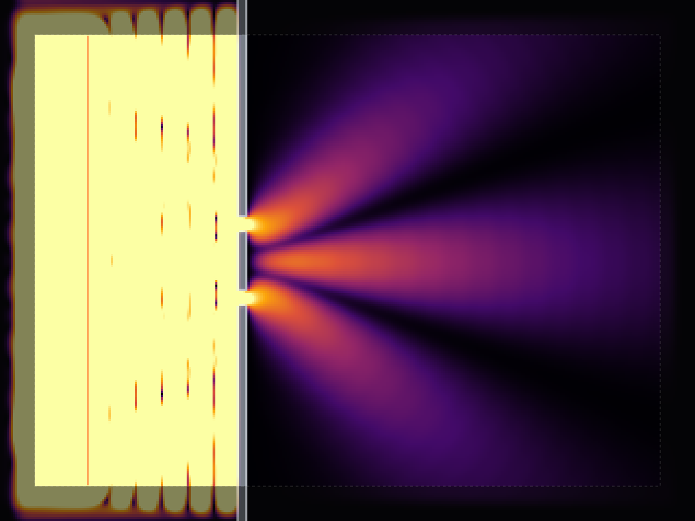
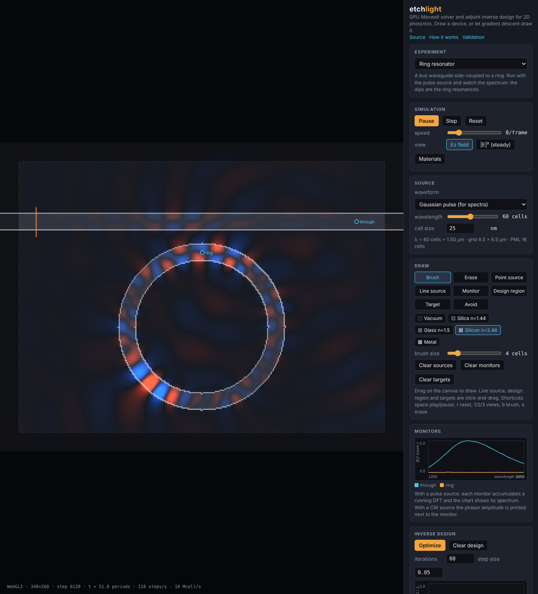

# etchlight

2D electromagnetic simulation (FDTD) that runs on the GPU in your browser, plus adjoint-method inverse design. You can draw a photonic device and watch light go through it, or draw a target and let the optimizer figure out the device.

Live: https://aditya-gautham.github.io/etchlight/


The "focus light" preset. The design region starts out uniform and after ~36 iterations it's a lens. White lines are permittivity contours. Intensity at the green target went up about 21x.



Same idea for a 1x2 splitter, silicon in silica at 1550 nm, intensity view.

## what it does

- Solves Maxwell's equations in 2D (TM polarization) with the Yee FDTD scheme and a split-field PML so waves leave the domain instead of bouncing back.
- Runs in WebGL2 fragment shaders. There's also a CPU version with the exact same update equations, which is what the tests run against. The two agree to ~1e-6.
- Point monitors accumulate running DFTs, so you can send a pulse through a ring resonator and get a spectrum out. The whole-grid DFT gives the steady state intensity map.
- Inverse design with the adjoint method: one forward sim and one adjoint sim give the gradient of the objective with respect to every cell in the design region. Filtered + projected density parameterization, Adam steps.
- Drawing tools for dielectrics and metals, point/line sources, monitors, design regions and targets. Scenes export to JSON.

Presets: double slit, dielectric lens, waveguide bend, ring resonator, photonic crystal, and three inverse design problems (focus, splitter, sharp bend).





## how it works

See [docs/physics.md](docs/physics.md). It goes through the grid and units, the lossy update, the PML, sources and the DFT, numerical dispersion, the adjoint derivation (including the correction you need for the discrete scheme), the parameterization, and how the GPU passes are laid out.

[docs/validation.md](docs/validation.md) has every number the test suite measures.

## validation

| check | result |
|---|---|
| Fresnel reflection at n=2, normal incidence | \|r\| = 0.338, theory 0.333 |
| phase velocity at 20 cells/wavelength | 0.994 c, which matches the dispersion relation |
| PML reflection, 16 cells | -54 dB |
| reciprocity (swap source and monitor) | 1e-7 relative |
| adjoint gradient vs finite differences | cosine 1.00000, scale 1.0001 |
| GPU vs CPU after 600 steps | 7e-7 of peak field |

These run in CI (`npm test` for the physics, `npm run e2e` for GPU/CPU parity in headless Chromium).

## things that went wrong

The adjoint gradient was about 2% off at first and I couldn't tell why. The textbook derivation gives dJ/dε = 2ω² Re(E λ). Against finite differences that had cosine similarity 0.9986, which is close enough that the optimizer still worked, but some cells were off by 80%. Turns out the leapfrog scheme sees ω̃ = (2/dt) sin(ω dt/2) instead of ω, and injecting the source after the curl update adds a factor of e^{iω dt/2}. Dividing the adjoint source by that fixed it (cosine 1.00000, scale 1.0001).

The GPU also disagreed with the CPU by 1e-3 right at the source cells. The shader was computing cos(ωt + φ) itself and GPU trig is allowed to be approximate. Now all the time dependent trig happens on the CPU in double and gets passed in as uniforms.

## running it

```
npm install
npm run dev
npm test
npm run build
npm run e2e
```

The e2e script uses software WebGL so it's slow. It's there for correctness, not speed.

## layout

```
src/core/    solver, PML, sources, DFT, adjoint, parameterization (no DOM)
src/gpu/     WebGL2 engine, shaders, renderer
src/ui/      the app
src/presets.ts
tests/       vitest
e2e/         playwright parity test
tools/       readme media capture
docs/
```

No framework, the UI is plain DOM.

## limitations

2D and TM only. Materials are non-dispersive (the "metal" is just a conductor with σ=20). The split-field PML gets worse at grazing angles, a CPML would be better. The objective is intensity at target cells; for real waveguide devices you'd want a mode overlap objective. The filter radius is the only feature size control, so designs can still have thin bridges near the projection threshold. Optimizing on the CPU engine works but is slow.

## references

Taflove & Hagness, Computational Electrodynamics (3rd ed). Berenger 1994 (PML). Jensen & Sigmund 2011 (topology optimization for photonics). Piggott et al. 2015. Hughes et al. 2019 (ceviche). Hammond et al. 2022 (Meep adjoint).

MIT license.
